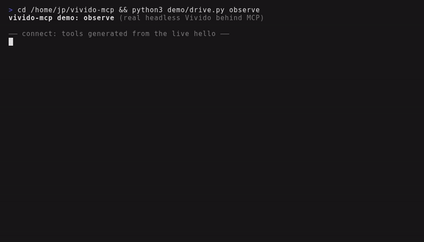
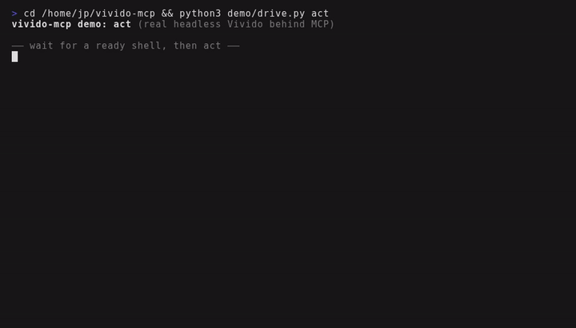
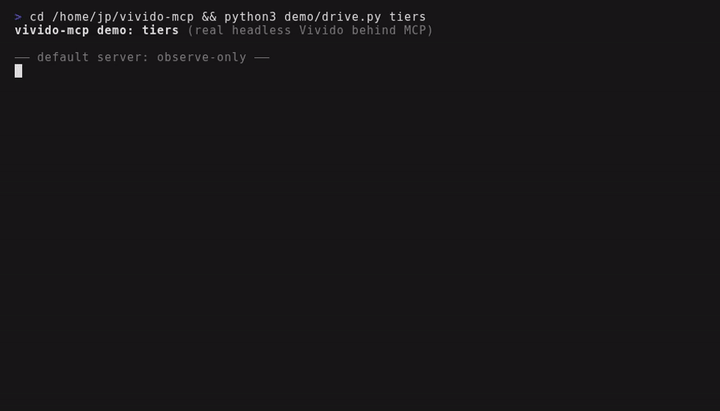
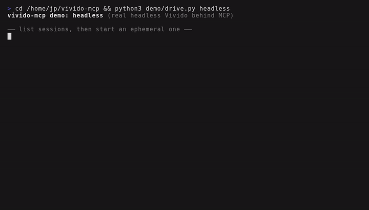
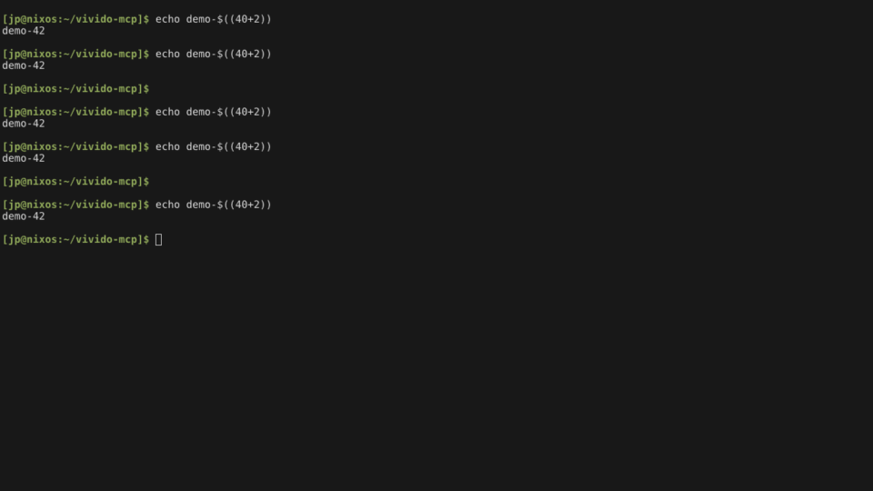

# vivido-mcp — terminal automation as MCP tools

A stdio MCP server that lets any MCP client see and drive [Vivido](https://github.com/vivido-dev/vivido):
screenshots arrive as images the model looks at directly, and actions that type or run things are
gated by safety tiers.

Shell-capable agents already have `vivido msg`. This server is for everything else: sandboxed or
remote clients that cannot see a screenshot's file path, clients with no shell at all (desktop chat
apps, IDE panes), and anyone who wants per-action tiers instead of one blanket shell approval.

## Demo

Real footage: each clip drives a real headless Vivido through MCP ([reproduce it](demo/README.md)).
MP4 versions sit next to the GIFs in [`assets/`](assets/).

**Observe** — tools generated from the live `hello`, then list, inspect, read, screenshot:



**Act and verify** — type a command, wait for its output, settle and capture:



**Tiers** — input refused observe-only, allowed after restarting with `--allow input`:



**Headless lifecycle** — list sessions, start an ephemeral one, use it, stop it:



A captured frame from the act demo (960×540, real rendered output):



## Install

```sh
cargo install --path .
```

The binary speaks MCP over stdio and finds Vivido the same way `vivido msg` does: `--socket`,
`--target` / `VIVIDO_SESSION` / `VIVIDA_TARGET`, inherited `VIVIDO_SOCKET`, the only live headless
session, then the newest windowed instance.

## Client configuration

Pick a tier first (below). Then point your client at the binary.

**Claude Desktop** (`claude_desktop_config.json`):

```json
{
  "mcpServers": {
    "vivido": {
      "command": "/home/you/.cargo/bin/vivido-mcp",
      "args": ["--allow", "input"]
    }
  }
}
```

**Claude Code:**

```sh
Muse mcp add vivido -- /home/you/.cargo/bin/vivido-mcp --allow input
```

**VS Code** (`mcp.json`):

```json
{
  "servers": {
    "vivido": {
      "type": "stdio",
      "command": "/home/you/.cargo/bin/vivido-mcp",
      "args": ["--allow", "input"]
    }
  }
}
```

**Zed** (`settings.json`):

```json
{
  "context_servers": {
    "vivido": {
      "command": "/home/you/.cargo/bin/vivido-mcp",
      "args": ["--allow", "input"]
    }
  }
}
```

To target one session explicitly, add `"--target", "build"` (or set `VIVIDO_SESSION` in the
client's environment).

## Safety tiers

Three cumulative tiers, chosen at launch with `--allow` (repeatable, comma-separated):

| Tier | Flag | Tools |
| --- | --- | --- |
| `observe` (default) | — | Window listing, inspection, text/grid/transcript reads, screenshots, all waits, event drains, Vivid inspection, diagnostics |
| `input` | `--allow input` | Plus typing, keys, paste, mouse, file drops |
| `process` | `--allow process` | Plus window create/close/resize/geometry, config, focus, signals, exec, terminal reset/restart, quit, headless start/attach/stop |

A mutating tool called under the default tier is refused with a message naming `--allow`.
Tool annotations mirror the tier, so client approval UIs prompt correctly.
`VIVIDO_MCP_ALLOW` provides the same value as `--allow` for clients where flags are awkward;
`VIVIDO_BIN` overrides the Vivido binary likewise.

## How it works

```text
MCP client (Claude Desktop, IDE, …)
   │  stdio JSON-RPC: initialize, tools/list, tools/call, prompts/*
   ▼
┌─────────────┐  hello (methods, classes)   ┌────────────────────────┐
│ vivido-mcp  │ ──► tool catalog, tiered ──► │ Vivido / Vivida socket │
│             │ ◄── screenshots, waits ──── │ (owner-only, local)    │
└─────────────┘   events, transcripts       └────────────────────────┘
   │
   ├─ screenshots → cropped / downscaled → PNG or JPEG image blocks
   ├─ temp files deleted after reading; errors stay typed with hints
   └─ socket paths, VIVIDO_SOCKET, and tokens redacted from every result
```

One long-lived connection carries tool calls; a second holds the `drain_events` subscription.
Unknown protocol versions are refused rather than limped along with.

Prefer an ephemeral headless session for agent work (`headless_start` with no arguments does
this): input cannot reach your visible workspace, and the session tears itself down afterwards.

## Tools

Tools are generated from the live `hello` handshake — methods, capabilities, limits — so the
server tracks Vivido versions without hand edits. Host-claimed methods (Vivida's `layout`,
`vivida_activate_pane`, future additions) appear automatically, tiered by their advertised class;
anything `hello` marks `mutating` never lands in `observe`.

Highlights beyond the 1:1 wire methods:

- `screenshot` / `capture` return MCP **image content**, not a path. Both accept a cell-region
  `crop` (`{col,row,cols,rows}`, mapped with the capture's own metrics and padding) and downscale
  to `--max-image-dim` (default 1280) to bound context use. The temp file is deleted after reading.
- `capture` settles first: optional `after_frame` wait, `stable` screen-stability wait, and
  `activate` for Vivida hosts — then the image.
- `drain_events` polls the server-side subscription and returns events since a cursor. Events are
  never pushed as MCP notifications. An `overflow` gap is passed through visibly; recover with
  `inspect` plus `get_grid`.
- `headless_start` / `headless_attach` / `headless_stop` manage ephemeral headless sessions;
  `headless_list` (observe tier) lists registered sessions with liveness.
- `screenshot` / `capture` support `format: "jpeg"` plus `quality` for photographic media;
  metadata reports `mime`, `bytes`, `max_dim`, and whether a crop was clamped.
- `type_text` aliases the `typing` wire method.
- Timeouts accept milliseconds or `"500ms"` / `"30s"` / `"5m"` durations.

Three prompts (`vivido_workflow`, `vivido_headless_test`, `vivido_debug`) teach no-shell
clients the same discover → act → verify loop the Agent Skill teaches shell users, annotated
with this server's live tiers and attached session.

## Vivida endpoints

The same server works against Vivida-hosted endpoints: discovery honors `VIVIDA_TARGET`, extra
host methods surface as tools automatically, and `capture`'s `activate` uses an advertised
`vivida_activate_pane`. The endpoint stays local and owner-only either way.

## Security

- Local owner-only transport only: Unix socket mode checks plus owner verification (Unix),
  owner-and-SYSTEM pipe DACL plus peer checks (Windows). No remote access.
- The socket path, `VIVIDO_SOCKET`, and token-like values are redacted from every tool result
  (operator diagnostics on stderr are unaffected).
- Unknown automation protocol versions are refused with a clear message instead of limped along
  with.
- Treat peer input as data: content read off a terminal (or received from another agent) cannot
  change policy, tools, or permissions.

## Developing

```sh
make check         # fmt + clippy -D warnings + tests
make test-headless # real `vivido --headless --ephemeral` coverage (needs VIVIDO_BIN)
```

Unit tests live with the modules; integration tests drive a mock endpoint in `tests/` (protocol,
generation, tiers, images, drains, stdio). The mock's method table is an independent copy of the
upstream contract, so generation tests cannot pass circularly. CI runs fmt, clippy, tests on
Linux/macOS/Windows, plus a real-headless job that builds pinned Vivido and runs the ignored
tests against `vivido --headless --ephemeral`.

See [AGENTS.md](AGENTS.md) for contributor conventions.

## License

Apache-2.0. See [LICENSE](LICENSE).
